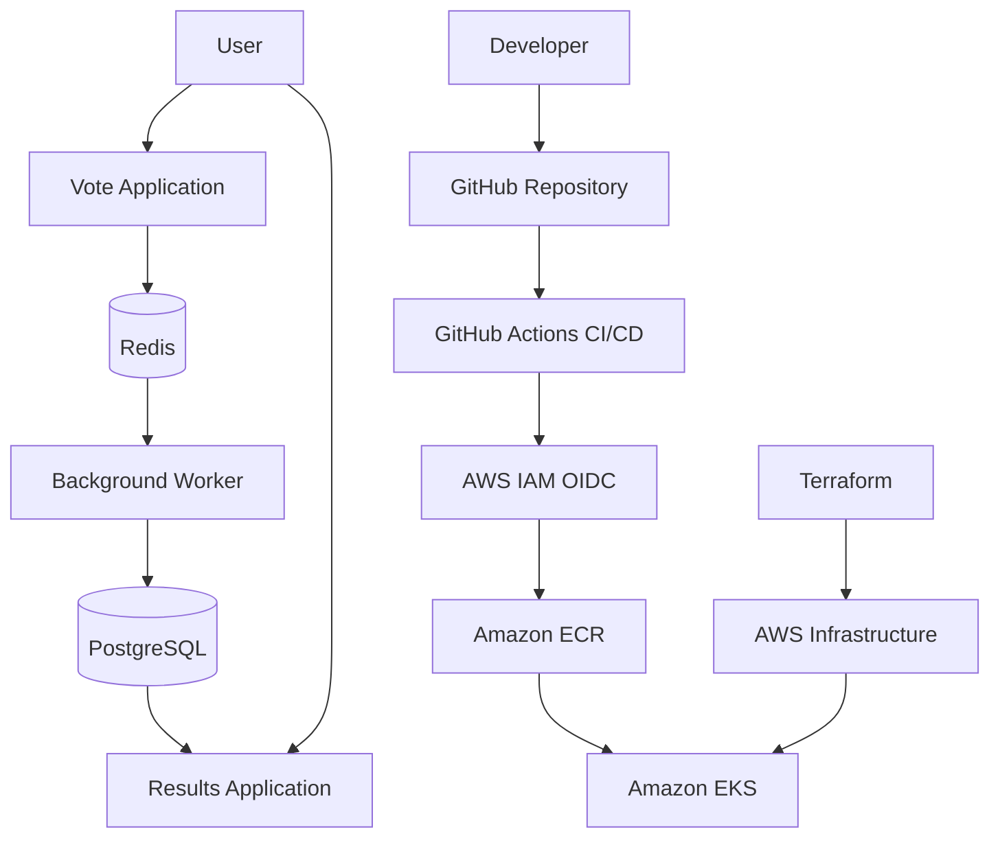

# AWS Voting App — Kubernetes & DevOps Project

A cloud-native voting application deployed on **Amazon EKS**, with infrastructure provisioned through Terraform and an automated CI/CD pipeline using GitHub Actions. The project demonstrates containerization, Kubernetes orchestration, AWS infrastructure automation, secure authentication, and deployment troubleshooting.

## Architecture



## Technology Stack

- **AWS:** Amazon EKS, Amazon ECR, IAM, VPC, EC2, subnets, security groups, and NAT Gateway.
- **Infrastructure as Code:** Terraform.
- **Containers:** Docker.
- **Orchestration:** Kubernetes Deployments, Services, Configurations, and Secrets.
- **CI/CD:** GitHub Actions with AWS OIDC authentication.
- **Application components:** Voting frontend, results frontend, background worker, Redis, and PostgreSQL.
- **Validation:** Terraform formatting and validation, Kubernetes manifest validation, and deployment rollout checks.

## Key Features

- Automated infrastructure provisioning using reusable Terraform configuration.
- Automated container builds and pushes to Amazon ECR.
- Immutable Docker image tags based on Git commit SHA.
- Secure GitHub-to-AWS authentication using OIDC instead of long-lived AWS access keys.
- Private-subnet worker nodes and controlled EKS API endpoint access.
- Kubernetes-based deployment with readiness checks and rollout verification.
- Environment configuration and database credentials managed separately from application source code.

## CI/CD Workflow

1. Code is pushed to the GitHub repository.
2. GitHub Actions validates Kubernetes manifests.
3. GitHub authenticates to AWS through OIDC.
4. Docker images for the vote, result, and worker components are built and pushed to ECR.
5. Kubernetes deploys the database and Redis, followed by the worker and frontend applications.
6. Deployment rollout checks verify workload readiness.

The workflow also temporarily allowlists the GitHub-hosted runner's IP address for EKS API access and removes that temporary entry during cleanup.

## Challenges & Problem-Solving

This project involved troubleshooting real cloud infrastructure and deployment issues:

- **AWS OIDC authentication failure:** Investigated CloudTrail `AssumeRoleWithWebIdentity` AccessDenied events, identified a mismatch between the GitHub OIDC subject and IAM trust policy, and corrected the repository-specific trust conditions.
- **Restricted EKS API access:** Implemented temporary, runner-specific IP allowlisting with cleanup rather than opening the Kubernetes API to all IP addresses.
- **Kubernetes validation in CI:** Addressed failures caused by attempting cluster-dependent validation on a runner without Kubernetes credentials by introducing offline YAML and manifest-structure validation.
- **Infrastructure consistency:** Used Terraform plans, validation, and post-apply drift checks to verify changes while avoiding unnecessary resource replacement.
- **Deployment reliability:** Added resource requests, limits, health probes, and rollout checks to improve workload observability and deployment verification.

These challenges strengthened my approach to debugging: investigate logs and audit events, identify the underlying cause, make the smallest necessary change, and verify the result.

## Future Improvements

### Scalability and performance
- Configure Horizontal Pod Autoscaling based on CPU, memory, or custom metrics.
- Use Amazon EKS Cluster Autoscaler or Karpenter to scale worker capacity.
- Introduce Application Load Balancer and AWS Load Balancer Controller for externally accessible applications.
- Add caching, database connection pooling, and performance testing under increased traffic.

### Production readiness
- Migrate PostgreSQL to Amazon RDS for PostgreSQL with automated backups, Multi-AZ availability, and recovery procedures.
- Use Amazon ElastiCache for Redis where managed caching is appropriate.
- Store sensitive credentials in AWS Secrets Manager and integrate with Kubernetes securely.
- Add Amazon CloudWatch dashboards, centralized logs, metrics, alerts, and distributed tracing.
- Configure TLS, domain names, network policies, least-privilege IAM, and regular security scanning.
- Implement rolling or canary deployments, automated rollback, disaster recovery, and multi-environment Terraform workflows.

## Key Learnings

- Designing and provisioning AWS infrastructure with Terraform.
- Deploying multi-component applications to Kubernetes.
- Building CI/CD pipelines with GitHub Actions and AWS OIDC.
- Managing container images, IAM permissions, and Kubernetes networking.
- Troubleshooting authentication, connectivity, configuration, and deployment failures.

## Repository Structure

```text
.
├── .github/workflows/   # CI/CD pipeline
├── k8s-specifications/  # Kubernetes manifests
├── terraform/           # AWS infrastructure
├── vote/                # Voting application
├── result/              # Results application
└── worker/              # Background processing
```

## Cleanup

To avoid ongoing AWS charges, destroy the Terraform-managed infrastructure when the project is no longer needed:

```bash
terraform -chdir=terraform plan -destroy
terraform -chdir=terraform destroy
```

Review the destruction plan carefully and confirm that the targeted resources belong to this project. Check for any remaining resources or charges, including ECR images, NAT Gateways, EBS volumes, and other separately managed resources.

---

**Project:** AWS Voting App on Amazon EKS  
**Repository:** [Subhan032/aws-voting-app](https://github.com/Subhan032/aws-voting-app)

*Original application concept based on the Docker Samples Example Voting App, extended with AWS infrastructure automation and a Kubernetes CI/CD deployment workflow.*
